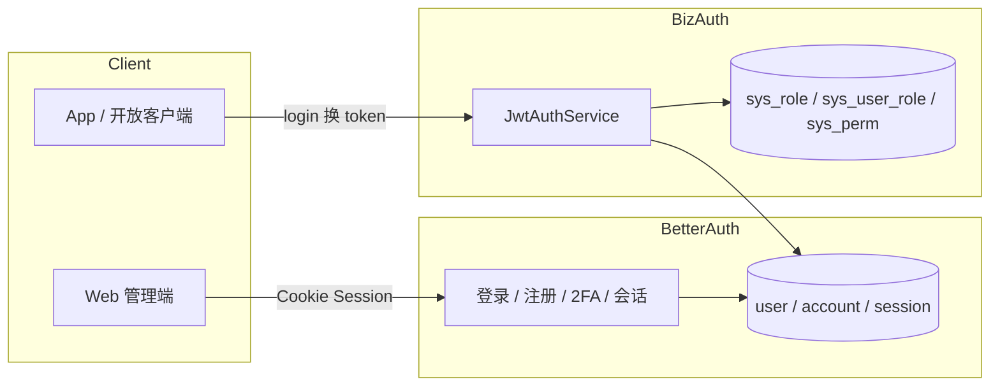

# 用户表与 Token 认证设计

本文给出 enterprise-admin-server 的用户/角色/权限表设计，以及 Token 认证能力方案（基于已选型的 Better Auth 嵌入式集成）。评审通过后按文末「落地步骤」实现。

## 1. 背景与约束

| 项 | 现状 |
| --- | --- |
| 服务形态 | 单体 admin API（NestJS + Fastify），非独立认证中心 |
| 认证库 | Better Auth（嵌入）+ `@thallesp/nestjs-better-auth` |
| 数据库 | MySQL 直连（TypeORM + Better Auth 同库） |
| 缓存 | Redis 直连（`REDIS_CLIENT`） |
| 既有配置 | `config.jwt.*`、`config.db.*` |

**核心原则：**

1. **账号与登录态归 Better Auth**，不自建 password/session 轮子。
2. **业务侧角色/菜单/接口权限**用 TypeORM 表维护，与 Better Auth 的 `role` 对齐或映射。
3. **Token 双轨**：浏览器用 Better Auth Session（Cookie）；移动端/开放接口用 JWT（`config.jwt.*`）。

## 2. 方案总览



| 轨道 | 载体 | 适用 | 有效期（默认） |
| --- | --- | --- | --- |
| Session | `better-auth.session_token` Cookie | 管理端 Web | 7 天滑动续期 |
| JWT Access | `Authorization: Bearer` | App / API | 2h |
| JWT Refresh | `Authorization: Bearer` | 续期 | 7d，存 Redis 黑名单/轮换 |

## 3. 表设计

### 3.1 Better Auth 负责的表（由库迁移生成，只读业务）

> 名称为默认单数风格，以迁移脚本为准。业务**不要**直接 UPDATE 密码/会话。

| 表 | 作用 | 关键字段 |
| --- | --- | --- |
| `user` | 账号主档 | `id`, `email`, `name`, `emailVerified`, `role`, `banned`, `banReason`, `banExpires`, `createdAt`, `updatedAt` |
| `account` | 凭证（密码哈希、OAuth） | `providerId`（`credential`）、`password`、`userId` |
| `session` | Web 会话 | `sessionToken`, `userId`, `expiresAt`, `ipAddress`, `userAgent` |
| `verification` | 邮件验证 / 2FA 辅助 | `identifier`, `value`, `expiresAt` |
| `twoFactor`（插件） | 2FA 密钥 | `userId`, `secret`, `backupCodes` |

`user.role` 与下文 `sys_role` 对齐：至少 `admin` / `user`；扩展角色写入 `sys_user_role` 并在登录后合并进 JWT/Session claims。

### 3.2 业务权限表（TypeORM，自管）

#### `sys_role` 角色

| 字段 | 类型 | 约束 | 说明 |
| --- | --- | --- | --- |
| `id` | bigint PK AI | | |
| `code` | varchar(64) | UK | 角色码，如 `ROLE_ADMIN` |
| `name` | varchar(64) | | 显示名 |
| `description` | varchar(255) | NULL | |
| `sort` | int | default 0 | |
| `status` | tinyint | default 1 | 1 启用 / 0 停用 |
| `created_at` | datetime | | |
| `updated_at` | datetime | | |

#### `sys_permission` 权限（API 级）

| 字段 | 类型 | 约束 | 说明 |
| --- | --- | --- | --- |
| `id` | bigint PK AI | | |
| `code` | varchar(128) | UK | 如 `user:list`、`user:create` |
| `name` | varchar(64) | | |
| `type` | tinyint | | 1 菜单 / 2 按钮 / 3 API |
| `method` | varchar(16) | NULL | API：GET/POST… |
| `path` | varchar(255) | NULL | API：`/api/users` |
| `parent_id` | bigint | default 0 | 菜单树 |
| `sort` | int | default 0 | |
| `status` | tinyint | default 1 | |
| `created_at` | datetime | | |
| `updated_at` | datetime | | |

#### `sys_user_role` 用户-角色

| 字段 | 类型 | 约束 | 说明 |
| --- | --- | --- | --- |
| `user_id` | varchar(64)/bigint | PK, FK→`user.id` | 与 Better Auth `user.id` 类型一致 |
| `role_id` | bigint | PK, FK→`sys_role.id` | |

#### `sys_role_permission` 角色-权限

| 字段 | 类型 | 约束 | 说明 |
| --- | --- | --- | --- |
| `role_id` | bigint | PK, FK | |
| `permission_id` | bigint | PK, FK | |

#### `sys_login_log` 登录审计（可选但建议）

| 字段 | 类型 | 说明 |
| --- | --- | --- |
| `id` | bigint PK | |
| `user_id` | varchar(64)/bigint | |
| `success` | tinyint | |
| `ip` | varchar(64) | |
| `user_agent` | varchar(255) | |
| `message` | varchar(255) | 失败原因 |
| `created_at` | datetime | |

### 3.3 索引建议

```text
sys_role.code            UK
sys_permission.code      UK
sys_user_role(user_id)   IDX
sys_user_role(role_id)   IDX
sys_role_permission(role_id), (permission_id)
sys_login_log(user_id), (created_at)
```

### 3.4 与 Better Auth 的 ID 策略

- `user.id` 默认为 Better Auth 生成的字符串 id。
- 业务表外键用 **`user_id` 字符串**（或统一 `varchar(64)`），避免自造第二套用户主键。
- 禁止用 `email` 做业务关联主键（可改邮箱）。

## 4. Token 认证能力

### 4.1 登录流程（Web / Session）

1. `POST /api/auth/sign-in/email`（Better Auth 插件路由）
2. 校验通过 → 写 `account`/`session` → 下发 HttpOnly Cookie `better-auth.session_token`
3. 业务 `AuthGuard`（`@thallesp/nestjs-better-auth`）从 Cookie 恢复会话
4. 读 `sys_user_role` → 组装 `roles[]` / `permissions[]` 放入请求上下文

### 4.2 JWT 流程（App / API）

```text
POST /api/auth/jwt/login
  { username/email, password }
    → Better Auth 校验密码（signIn）
    → 签发 access_token + refresh_token
    → refresh_token 存 Redis（key: eas:refresh:{userId}:{jti}）

POST /api/auth/jwt/refresh
  { refresh_token }
    → 校验 Redis 未吊销、未过期、未使用
    → 轮换 refresh（旧的立刻失效）
    → 签发新 access

POST /api/auth/jwt/logout
  → 吊销 Redis refresh + 加入 access 短期黑名单（可选）
```

| Token | 存放 | 载荷 claims |
| --- | --- | --- |
| access | 客户端内存 / Authorization | `sub`, `email`, `roles[]`, `perms[]`（可截断）, `jti`, `iat`, `exp` |
| refresh | Redis + 客户端 | `sub`, `jti`, `exp`；**不放权限** |

默认有效期：`JWT_EXPIRES_IN=2h`，`JWT_REFRESH_EXPIRES_IN=7d`（已有配置）。

### 4.3 权限校验

```text
Guard 顺序
  1. SessionAuthGuard / JwtAuthGuard   → 是否登录
  2. RolesGuard                        → @RequireRoles('admin')
  3. PermissionsGuard                  → @RequirePermissions('user:list')
```

- 装饰器：`@Public()` / `@RequireRoles()` / `@RequirePermissions()`
- 粗粒度：路由前缀 + method 对应 `sys_permission.type=3`
- 细粒度：业务 service 内再判

### 4.4 并发登录 / 踢下线（Sa-Token 习惯）

| 能力 | 做法 |
| --- | --- |
| 单端登录 | 登录成功后删该用户其他 session；JWT refresh 只保留最新 `jti` |
| 踢下线 | `sys_user` 状态改禁用 → Guard 查缓存；或 Redis 记 `user:kick:{userId}` |
| 封禁 | Better Auth `admin` 插件 `banned`，与 `sys_role.status` 联动 |

### 4.5 安全约定

1. 密码只存 Better Auth `account.password`（哈希），业务表不存密码。
2. Cookie：`HttpOnly` + `Secure`（生产）+ `SameSite=Lax`（跨站前端再调）。
3. JWT 密钥继续 `config.jwt.secret`；`staging/production` 长度与哨兵校验已覆盖。
4. 登录失败 N 次锁定：Redis 计数 `eas:login:fail:{id}`，阈值后短时拒绝。
5. 敏感接口（改密、授权）写审计日志。

## 5. API 草图

| 方法 | 路径 | 说明 | 鉴权 |
| --- | --- | --- | --- |
| POST | `/api/auth/sign-in/email` | Web 登录 | 匿名 |
| POST | `/api/auth/sign-out` | 登出 | Session |
| GET | `/api/auth/me` | 当前用户+角色权限 | Session/JWT |
| POST | `/api/auth/jwt/login` | 颁发双 Token | 匿名 |
| POST | `/api/auth/jwt/refresh` | 刷新 Token | refresh |
| POST | `/api/auth/jwt/logout` | 吊销 Token | 登录 |
| GET | `/api/users` | 用户列表 | `user:list` |
| POST | `/api/users` | 创建用户 | `user:create` |
| PUT | `/api/users/:id/roles` | 分配角色 | `user:assign-role` |
| GET | `/api/roles` | 角色列表 | `role:list` |
| PUT | `/api/roles/:id/permissions` | 分配权限 | `role:assign-perm` |

响应信封仍走现有 `ResponseInterceptor`。

## 6. 模块划分

```text
src/
  auth.ts                 # Better Auth 实例（已存在）
  modules/auth/
    guards/               # Session / JWT / Roles / Permissions
    decorators/           # @Public @RequireRoles ...
    jwt/                  # 签发、校验、refresh 轮换
    dto/
  modules/user/           # 用户管理、分配角色
  modules/rbac/           # 角色、权限
  entities/
    sys-role.entity.ts
    sys-permission.entity.ts
    sys-user-role.entity.ts
    sys-role-permission.entity.ts
    sys-login-log.entity.ts
```

## 7. 落地步骤

1. 建 TypeORM 实体与迁移（`sys_*`），`user_id` 与 Better Auth 字符串 id 对齐。
2. 生成 Better Auth 表结构（官方迁移 / 启动引导），`admin` 插件已就绪。
3. 实现 `JwtAuthService`（登录换双 Token、refresh 轮换、Redis 吊销）。
4. 实现 Guard + 装饰器，挂 `APP_GUARD`；业务控制器加权限码。
5. 用户/角色/权限 CRUD 与审计日志。
6. 单测：登录、过期、refresh 重放、踢下线、权限拒绝。

## 8. CR 关注点

- [ ] `user_id` 用 Better Auth 字符串 id 是否可接受（vs 自造自增用户表）
- [ ] 是否同时保留 Session（Web）+ JWT（App）双轨，还是只要 JWT
- [ ] 权限粒度：只要角色，还是角色 + 菜单 + API 权限码
- [ ] refresh 是否轮换 + Redis，或仅无状态 JWT
- [ ] `organization()` 插件是否纳入本期（影响是否加 `sys_org`）
- [ ] 登录锁定策略（失败次数/时长）是否需要产品定义
